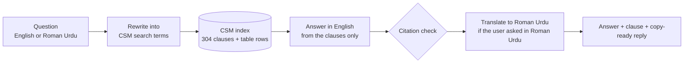

# Utility Rules Copilot · CSM Help Desk

**Ask the NEPRA Consumer Service Manual in English or Roman Urdu. Get a short answer, the exact clause it comes from, and a reply you can paste into WhatsApp.**

Utility Rules Copilot is a help desk for DISCO front-desk staff, call centres and electricity consumers in Pakistan. It answers questions such as *"Meter kharab ho gaya hai, bill kaise aayega?"* or *"Who sanctions a 50 kW new connection?"* using only the **NEPRA Consumer Service Manual (CSM, as on 26 Nov 2025)**, and always shows the rule behind the answer.

It runs entirely on a local computer with open-source models. No cloud AI service, no API keys, and no customer data leaves the building.

> **Status:** working product on the full CSM 2025. Not an official NEPRA or DISCO product. Looking for a pilot with a DISCO customer-service centre.

---

## What it does

| Part | What the user gets |
|---|---|
| **🔌 New connection · ⚡ Meter & bills · ✂️ Disconnection & deposit** | Ask in English or Roman Urdu, or click a common question. The answer cites the CSM clause, the clause text is shown beside it with the deciding sentence highlighted, and a **copy-ready reply** is prepared for WhatsApp, SMS or a complaint ticket. |
| **🧮 Calculators (no AI)** | Exact answers from hand-checked CSM tables: who sanctions a connection and how many days it may take (2.10.1, Annex-III), dedicated transformer requirement (2.6), security deposit in rupees (Annex-IV), assessed house load (Annex-VI). |
| **📖 Browse the manual** | All 16 chapters and annexures, clause by clause with page numbers, instant keyword search, and a link to the official NEPRA PDF. |
| **"Not covered" answers** | If the manual does not cover a question, the copilot says so and refers the user to the DISCO office instead of guessing. |

---

## Results (measured October 2026)

| Test | Result |
|---|---|
| Finding the right clause (top 5), 36 in-scope questions | **33 / 36** (English 17/19, Roman Urdu 16/17) |
| In-scope questions answered | **34 / 36** |
| Out-of-scope questions correctly referred to the DISCO | **8 / 9** |
| Invented clause references | **0** (citations are checked against the clauses actually retrieved) |
| Answer in the user's language | **44 / 45** |

Model: `qwen2.5:7b` (Apache 2.0) with `nomic-embed-text` (Apache 2.0) via Ollama, on a laptop. The test set is the project's own set of real consumer questions in English and Roman Urdu.

---

## How it works

1. **Clause-level index.** The CSM PDF is split into 304 clauses with chapter and section context; key tables are rebuilt as hand-checked CSV files instead of trusting PDF extraction.
2. **Question rewriting.** Roman Urdu and everyday words ("meter taiz chal raha hai") are turned into CSM terms, helped by an expert glossary.
3. **Answers from the manual only.** The model must quote the deciding sentence first, then answer; numbers, fees and officers not in the clauses are not allowed.
4. **Citation guard.** Any clause reference that was not actually retrieved is removed.
5. **Exact lookups.** Load-based questions (for example *50 kW*) use a table lookup in Python, not the model.

---

## Technology

Python · Streamlit · Ollama (`qwen2.5:7b`, `nomic-embed-text`) · ChromaDB · pypdf

All components allow commercial use (Apache 2.0, MIT, BSD). Model licences are included with the product.

---

## Screenshots

| | |
|---|---|
|  |  |
|  |  |

---

## Source code and pilots

The source code is private. A live demo or a pilot at a DISCO customer-service centre can be arranged on request.

Companion product: [Utility Data Copilot](https://github.com/akhterquddus-ops/utility-data-copilot) answers *"what does the data say?"*; this one answers *"what do the rules say?"*

**Built by Muhammad Akhtar Quddus** (AsaanDigital Applications), an energy and utilities technology consultant with 18 years in utility CIS and billing, AMI and smart metering.

- Portfolio: [akhterquddus-ops.github.io](https://akhterquddus-ops.github.io)
- LinkedIn: [linkedin.com/in/akhterquddus](https://linkedin.com/in/akhterquddus)

Source document: NEPRA Consumer Service Manual, published by NEPRA ([official PDF](https://nepra.org.pk/Legislation/7-Manuals/2025/CONSUMER%20SERVICE%20MANUAL%20(CSM)%20REVISED%202025.pdf)). Always confirm a specific case with your DISCO office.

© 2026 Muhammad Akhtar Quddus. All rights reserved.
